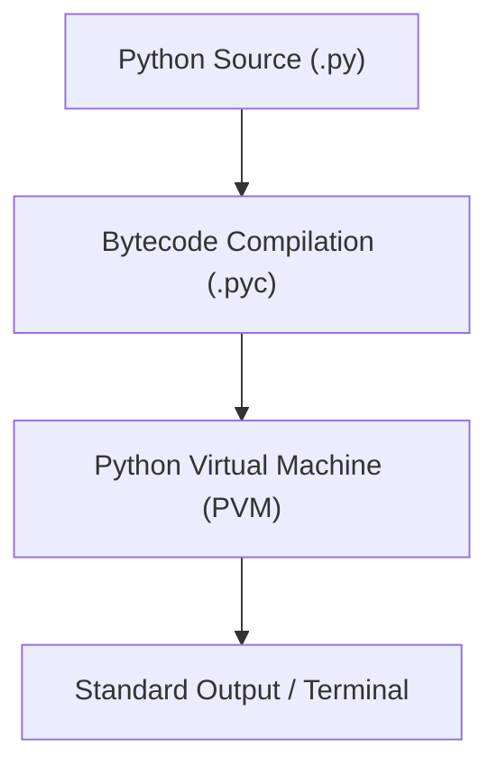
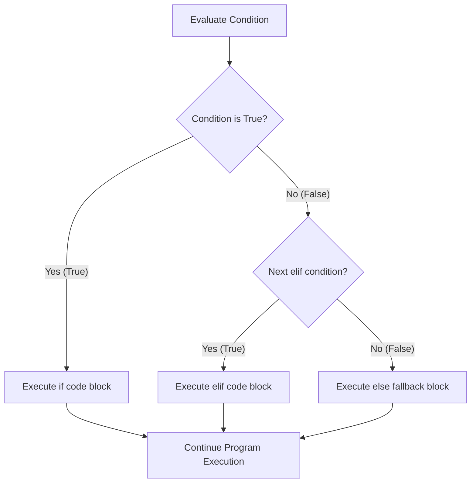
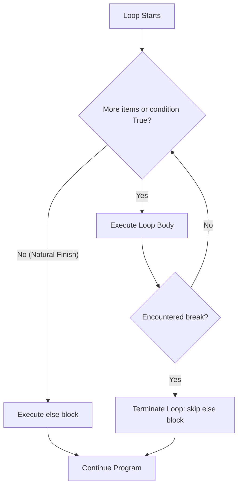
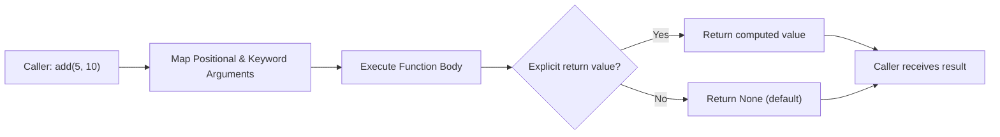
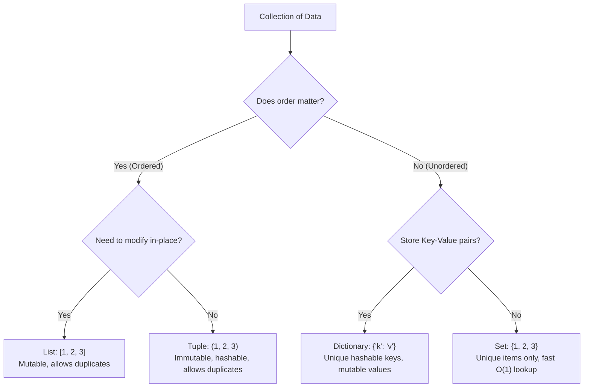
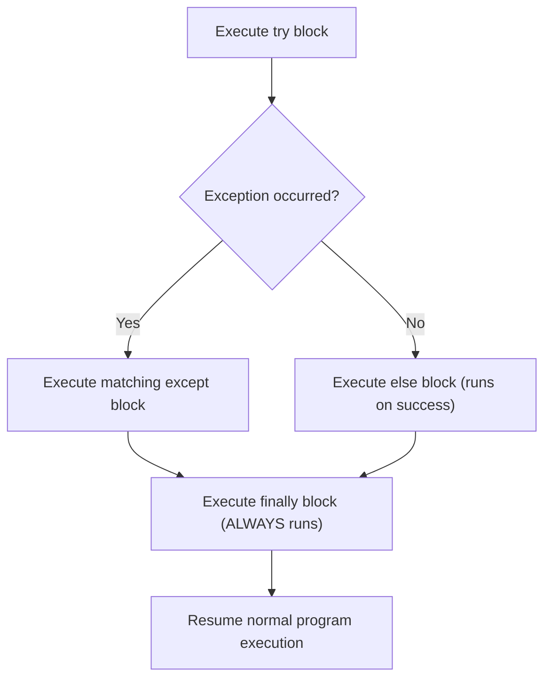

# 📘 Python Handbook & Study Notes

A curated, balanced study guide designed for conceptual clarity, quick revision, and handwritten note-taking. Each module outlines the core problem it solves, a clean hand-drawable diagram, minimal essential code, and golden interview rules.

---

## 📚 Table of Contents
- [Module 1: Basics, Variables & Operators (`01basics`)](#module-1-basics-variables--operators-01basics)
- [Module 2: Control Flow & Conditionals (`02control-flow`)](#module-2-control-flow--conditionals-02control-flow)
- [Module 3: Loops & Iterations (`03iterations`)](#module-3-loops--iterations-03iterations)
- [Module 4: Functions & Scope (`04functions`)](#module-4-functions--scope-04functions)
- [Module 5: Core Data Structures (`05data-structures`)](#module-5-core-data-structures-05data-structures)
- [Module 6: Exception Handling (`06exception-handling`)](#module-6-exception-handling-06exception-handling)
- [📊 Python Master Cheat Sheet](#-python-master-cheat-sheet)

---

## Module 1: Basics, Variables & Operators (`01basics`)

### 1. Core Purpose
Python is a dynamically typed, interpreted, high-level language. Variables do not require explicit type declarations; Python infers the type at runtime based on the assigned value.

### 2. Handbook Diagram


### 3. Essential Syntax & Patterns

```python
# 1. Variables & Dynamic Typing
name = "Sans"       # str
age = 21            # int
pi = 3.14           # float
is_active = True    # bool
data = None         # NoneType

# 2. Type Checking & Casting
print(type(age))    # Output: <class 'int'>
num_str = str(age)  # "21"
num_int = int("45") # 45

# 3. String Slicing: [start : stop : step]
# - start: inclusive (default: 0)
# - stop: exclusive (default: len)
# - step: stride (default: 1)
text = "PYTHON"
print(text[0:4:1])  # 'PYTH'
print(text[::-1])   # 'NOHTYP' (Reverse string trick)
print(ord("A"))     # 65 (Unicode code point)
print(chr(65))      # 'A'

# 4. Input & Formatted Output
user_input = int(input("Enter number: "))
print(f"Value squared is: {user_input ** 2}")

# 5. Core Operators
# Arithmetic: +  -  *  / (float)  // (floor division)  % (modulo)  ** (power)
# Comparison: ==  !=  >  <  >=  <=
# Logical   : and  or  not
```

### 4. Golden Rules for Your Handbook
* **Division Differences**: `/` always returns a float (e.g. `10 / 2` $\rightarrow$ `5.0`). Use `//` for integer floor division (e.g. `10 // 2` $\rightarrow$ `5`).
* **Strings are Immutable**: Modifying a character via `text[0] = 'J'` raises a `TypeError`. Slicing always creates a brand-new string.
* **`input()` Always Returns `str`**: Always wrap with `int()` or `float()` when numeric calculations are needed.

---

## Module 2: Control Flow & Conditionals (`02control-flow`)

### 1. Core Purpose
Control flow directs the execution path of a program based on boolean evaluations (`True` or `False`). Python uses **strict indentation (4 spaces)** to define blocks instead of curly braces `{}`.

### 2. Handbook Diagram


### 3. Essential Syntax & Patterns

```python
score = 85

# 1. if-elif-else Ladder
if score >= 90:
    grade = "A"
elif score >= 80:
    grade = "B"
elif score >= 70:
    grade = "C"
else:
    grade = "F"

# 2. Short-Hand / Ternary One-Liner
# Syntax: value_if_true if condition else value_if_false
status = "Adult" if age >= 18 else "Minor"

# 3. Falsy Values in Python
# Evaluates to False: 0, 0.0, "", [], (), {}, set(), None, False
items = []
if not items:
    print("List is empty!")  # Idiomatic Python check
```

### 4. Golden Rules for Your Handbook
* **First Match Wins**: In an `if-elif-else` ladder, once a condition evaluates to `True`, Python executes that block and immediately skips all remaining checks.
* **Indentation Defines Scope**: Mixing tabs and spaces raises a `TabError` or `IndentationError`. Always stick to 4 standard spaces.

---

## Module 3: Loops & Iterations (`03iterations`)

### 1. Core Purpose
Loops automate repetitive operations. Python provides `for` loops (best for iterating over sequences and ranges) and `while` loops (best when the number of iterations depends on a changing condition).

### 2. Handbook Diagram


### 3. Essential Syntax & Patterns

```python
# 1. for loop with range(start, stop, step)
for i in range(1, 10, 2):  # 1, 3, 5, 7, 9
    print(i, end=" ")

# 2. Loop Control: break vs continue
for n in range(1, 6):
    if n == 2:
        continue  # Skips only current iteration (skips 2)
    if n == 4:
        break     # Terminates the entire loop at 4
    print(n)      # Prints 1, then 3

# 3. The for...else & while...else Construct
# 'else' executes ONLY IF the loop finishes normally without encountering 'break'
target = 7
for num in [2, 4, 6, 8]:
    if num == target:
        print("Found target!")
        break
else:
    print("Target not found in list!")  # Executes here

# 4. while loop: Mathematical Digit Extraction Pattern
num = 1234
reversed_num = 0

while num > 0:
    digit = num % 10                        # Extract last digit
    reversed_num = reversed_num * 10 + digit # Append to reversed
    num = num // 10                         # Strip last digit

print(f"Reversed: {reversed_num}")  # Output: 4321
```

### 4. Golden Rules for Your Handbook
* **`range()` Stop is Exclusive**: `range(1, 5)` yields values `1, 2, 3, 4` (never reaches 5).
* **The `else` in Loops**: In Python, loop `else` blocks act as a "no-break" detector. Ideal for prime checks, search algorithms, and validation.
* **Prevent Infinite While Loops**: Ensure the loop variable is updated (`n += 1` or `n //= 10`) inside the body.

---

## Module 4: Functions & Scope (`04functions`)

### 1. Core Purpose
Functions encapsulate reusable logic into modular, callable blocks following the **DRY (Don't Repeat Yourself)** engineering principle.

### 2. Handbook Diagram


### 3. Essential Syntax & Patterns

```python
# 1. Definition, Parameters, and Return
def add(a, b):
    return a + b

result = add(10, 5)  # 15

# 2. Argument Types
# A. Positional Arguments: matched in exact order
def user_info(name, age):
    return f"{name} is {age} years old"

# B. Keyword Arguments: passed by name, order does not matter
user_info(age=21, name="Sans")

# C. Default Arguments: fallback value if omitted in call
# Note: Default parameters must ALWAYS follow non-default parameters!
def calculate_tax(amount, rate=0.18):
    return amount * rate

print(calculate_tax(1000))        # Uses default rate 0.18 -> 180.0
print(calculate_tax(1000, 0.05))  # Overrides default -> 50.0

# 3. Functions without return implicitly return None
def do_nothing():
    pass

print(do_nothing())  # Output: None
```

### 4. Golden Rules for Your Handbook
* **Parameter vs Argument**: Parameters are the variables in the function declaration (`def fn(x, y):`); arguments are the actual values passed during invocation (`fn(1, 2)`).
* **Default Argument Order**: Never put a default parameter before a non-default parameter (`def fn(a=1, b):` $\rightarrow$ `SyntaxError`).
* **Implicit Return**: If a function finishes without an explicit `return` statement, it returns `None`.

---

## Module 5: Core Data Structures (`05data-structures`)

Python provides four built-in collection data structures, each optimized for specific access patterns, mutability requirements, and uniqueness rules.

### 1. Handbook Comparison Diagram


---

### 2. Lists (`lists.py`)
* **Properties**: Mutable, Ordered, Allows Duplicates, Heterogeneous.
* **Essential Methods**:
  * `.append(x)`: Adds item to the end ($O(1)$).
  * `.insert(index, x)`: Inserts item at index, shifting elements right ($O(n)$).
  * `.extend(iterable)`: Appends elements from another list to the end.
  * `.remove(x)`: Removes first occurrence of value `x` (raises `ValueError` if absent).
  * `.pop(index)`: Removes and returns element at index (defaults to last item).

```python
nums = [10, 20, 30]
nums.append(40)          # [10, 20, 30, 40]
nums.insert(1, 15)       # [10, 15, 20, 30, 40]
nums.remove(20)          # [10, 15, 30, 40]
print("Index 0:", nums[0]) # Direct 0-based indexing
```

---

### 3. Tuples (`tuples.py`)
* **Properties**: Immutable, Ordered, Allows Duplicates, Heterogeneous.
* **Single-Element Quirk**: A trailing comma is required to create a 1-item tuple: `t = (5,)` is a `tuple`, while `t = (5)` is an `int`.
* **Why Use Tuples?**:
  1. **Data Integrity**: Guarantees read-only constants that cannot be altered.
  2. **Performance**: Less memory overhead and faster creation than lists.
  3. **Hashable**: Can be used as dictionary keys or set elements.
* **Only 2 Methods**: `.index(x)` and `.count(x)`.

```python
point = (10, 20)
x, y = point             # Tuple unpacking: x=10, y=20
val1, val2 = 1, 2
val1, val2 = val2, val1  # Pythonic swap via tuple unpacking
```

---

### 4. Sets (`sets.py`)
* **Properties**: Mutable container of Hashable items, Unordered, Unique (No Duplicates).
* **The Empty Set Quirk**: `{}` creates an empty `dict`. Always use `set()` to create an empty set!
* **Hashability**: Sets use hash tables internally, giving ultra-fast $O(1)$ average membership testing (`item in my_set`). Elements must be immutable/hashable.
* **Mathematical Operations**:
  * Union: `A | B` or `A.union(B)`
  * Intersection: `A & B` or `A.intersection(B)`
  * Difference: `A - B` or `A.difference(B)`
  * Symmetric Difference: `A ^ B` or `A.symmetric_difference(B)`

```python
s = {1, 2, 3, 3, 2}
print(s)                 # Output: {1, 2, 3} (Duplicates removed)
s.add(4)                 # Adds 4
s.discard(99)            # Safe removal: no error if item absent
```

---

### 5. Dictionaries (`dictionary.py`)
* **Properties**: Key-Value Mapping, Mutable, Unique Hashable Keys, Insertion Ordered (Python 3.7+).
* **Accessing Keys**:
  * `d[key]`: Fast lookup, but raises `KeyError` if key is missing.
  * `d.get(key, default)`: Safe lookup returning `None` (or default value) if missing.
* **Traversals**:
  * `for k in d:` iterates keys.
  * `for v in d.values():` iterates values.
  * `for k, v in d.items():` unpacks key-value pairs simultaneously.

```python
# 1. Declaration & Safe Access
user = {"name": "Sans", "role": "Dev"}
print(user.get("age", 21))   # Returns fallback default 21

# 2. Word Frequency Counter Pattern
sentence = "apple banana apple"
freq = {}
for word in sentence.split():
    freq[word] = freq.get(word, 0) + 1
# Output: {'apple': 2, 'banana': 1}
```

---

## Module 6: Exception Handling (`06exception-handling`)

### 1. Core Purpose
Exception handling manages runtime errors gracefully, preventing sudden script crashes and allowing programs to log errors, clean up resources, and recover smoothly.

### 2. Handbook Diagram


### 3. Essential Syntax & Patterns

```python
# 1. Errors vs Exceptions
# - SyntaxError / IndentationError: Parsing errors caught before code runs.
# - Exceptions (ZeroDivisionError, TypeError, ValueError, KeyError): Runtime errors.

# 2. Complete try-except-else-finally Suite
num_input = input("Enter divisor: ")

try:
    divisor = int(num_input)
    result = 100 / divisor
except ValueError:
    print("Invalid input! Please enter a valid integer.")
except ZeroDivisionError:
    print("Cannot divide by zero!")
except Exception as err:
    print(f"Unexpected error: {err}")
else:
    # Runs ONLY if NO exceptions were raised in the try block
    print(f"Division successful: {result}")
finally:
    # ALWAYS runs, regardless of whether exceptions were raised or caught
    # Ideal for closing files, network sockets, or database connections
    print("Execution complete. Cleaning up resources.")

# 3. Raising Custom Exceptions with 'raise'
age = -5
if age < 0:
    raise ValueError("Age cannot be negative!")
```

### 4. Golden Rules for Your Handbook
* **Specific Before Generic**: Always place specific exception handlers (`ZeroDivisionError`, `ValueError`) before the generic `except Exception` catch-all.
* **`finally` Always Executes**: The `finally` block runs even if a `return`, `break`, or unhandled exception occurs inside `try` or `except`.
* **Manual Validation**: Use `raise ValueError("message")` to enforce domain rules in your programs.

---

## 📊 Python Master Cheat Sheet

### Data Structures Comparison Matrix

| Data Structure | Syntax | Mutability | Ordered? | Duplicates? | Element Constraints | Primary Use Case |
| :--- | :--- | :--- | :--- | :--- | :--- | :--- |
| **List** | `[1, 2, 3]` | **Mutable** | Yes | Yes | Any type | Ordered sequences, dynamic stacks, queues |
| **Tuple** | `(1, 2, 3)` | **Immutable** | Yes | Yes | Any type | Read-only constants, coordinate pairs, dict keys |
| **Set** | `{1, 2, 3}` | **Mutable** | No | **No** | **Hashable only** | Deduplication, fast membership ($O(1)$), math set ops |
| **Dictionary**| `{"k": "v"}` | **Mutable** | Yes (3.7+) | Keys: **No**, Values: Yes | Keys: **Hashable only** | Key-value records, fast lookups ($O(1)$), JSON |

### Quick Syntax & Memory Hooks

| Topic | Syntax / Pattern | Golden One-Line Memory Hook |
| :--- | :--- | :--- |
| **String Slicing** | `s[start:stop:step]` | `[::-1]` reverses; stop index is always excluded. |
| **Single-item Tuple** | `(1,)` | Parentheses without a comma evaluate to a normal integer. |
| **Empty Set** | `set()` | `{}` creates an empty dictionary; use `set()` for sets. |
| **Dict Safe Access** | `d.get(key, default)` | Avoids `KeyError` by returning `None` or a custom fallback. |
| **Loop Else** | `for ... else:` | `else` runs only if the loop completes without hitting a `break`. |
| **Floor Division** | `//` | Standard `/` produces a float; `//` discards decimals. |
| **Clean Resource Exit** | `finally:` | Always runs even if errors or returns occur in `try`. |
| **Custom Errors** | `raise ValueError("msg")` | Manually triggers an exception when validation fails. |
