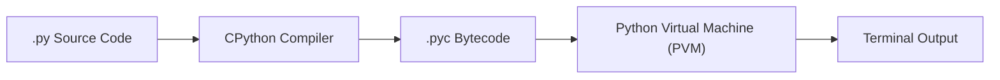
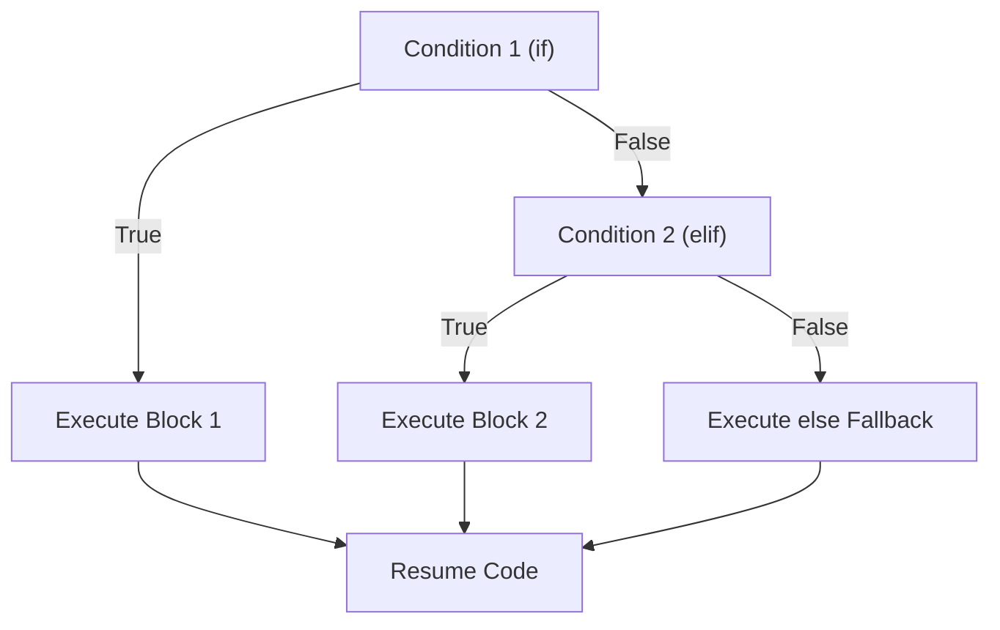
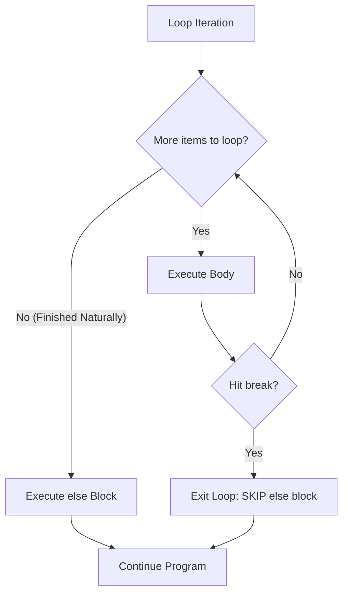
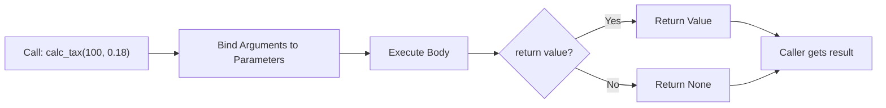
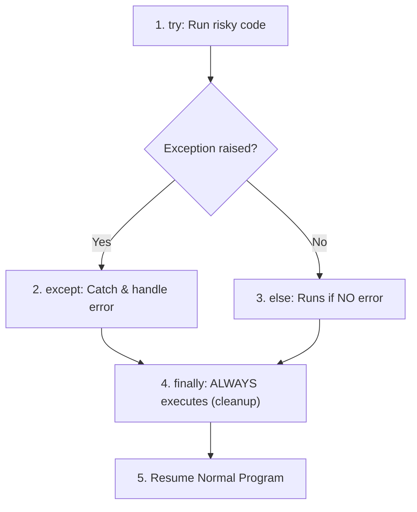

# 📘 Python Study Handbook

A structured, balanced reference guide covering core Python fundamentals, control flow, functions, data structures, and exception handling. Each section includes **Key Concepts**, **Visual Architecture Diagrams**, **Syntax Formulas & Examples**, and **Common Traps & Gotchas**.

---

## 📑 Table of Contents
- [Module 1: Python Basics & Strings (`01basics`)](#module-1-python-basics--strings-01basics)
- [Module 2: Operators & Expressions (`01basics`)](#module-2-operators--expressions-01basics)
- [Module 3: Control Flow & Conditionals (`02control-flow`)](#module-3-control-flow--conditionals-02control-flow)
- [Module 4: Loops & Iterations (`03iterations`)](#module-4-loops--iterations-03iterations)
- [Module 5: Functions & Scope (`04functions`)](#module-5-functions--scope-04functions)
- [Module 6: Lists — Mutable Sequences (`05data-structures`)](#module-6-lists--mutable-sequences-05data-structures)
- [Module 7: Tuples — Immutable Sequences (`05data-structures`)](#module-7-tuples--immutable-sequences-05data-structures)
- [Module 8: Sets — Unique Unordered Collections (`05data-structures`)](#module-8-sets--unique-unordered-collections-05data-structures)
- [Module 9: Dictionaries — Key-Value Hashmaps (`05data-structures`)](#module-9-dictionaries--key-value-hashmaps-05data-structures)
- [Module 10: Exception Handling (`06exception-handling`)](#module-10-exception-handling-06exception-handling)
- [📊 Quick Revision Matrix](#-quick-revision-matrix)

---

## Module 1: Python Basics & Strings (`01basics`)

### 1. Key Concepts
* **Interpreted & Dynamically Typed**: Variables do not need type declarations; types are bound at runtime based on assigned values.
* **Primitive Data Types**: `int` (42), `float` (3.14), `str` ("hello"), `bool` (`True`/`False`), `NoneType` (`None`).

### 2. Architecture Diagram: Python Execution Pipeline


### 3. String Indexing & Slicing Formula
```text
  +Index :   0   1   2   3   4   5
  Chars  : | P | Y | T | H | O | N |
  -Index :  -6  -5  -4  -3  -2  -1
```
* **Slicing Syntax**: `string[start : stop : step]`
  * `start` = inclusive (default: `0`)
  * `stop`  = exclusive (default: `len`)
  * `step`  = step size / direction (default: `1`)

### 4. Syntax & Examples
```python
s = "PYTHON"
print(s[0:4])    # 'PYTH' (stops before index 4)
print(s[::-1])   # 'NOHTYP' (Reverse string trick)
print(ord("A"))  # 65 (Character to Unicode)
print(chr(65))   # 'A' (Unicode to Character)

# User Input & Typecasting
age = int(input("Enter age: "))
print(f"Next year: {age + 1}")
```

### 5. ⚠️ Common Traps & Gotchas
* **Strings are Immutable**: `s[0] = 'J'` raises `TypeError`. Slicing always returns a new string.
* **`input()` Always Returns `str`**: Forgetting `int()` or `float()` causes string concatenation instead of arithmetic (`"5" + "5"` = `"55"`).

---

## Module 2: Operators & Expressions (`01basics`)

### 1. Key Concepts
Operators perform computations on variables and values. Python supports arithmetic, relational, logical, and assignment operations.

### 2. Operator Reference Table
| Category | Operator | Example | Result / Meaning |
| :--- | :--- | :--- | :--- |
| **Float Division** | `/` | `10 / 4` | `2.5` (Always returns float) |
| **Floor Division** | `//` | `10 // 4` | `2` (Discards decimal remainder) |
| **Modulo** | `%` | `10 % 3` | `1` (Returns remainder) |
| **Power / Exponent**| `**` | `2 ** 3` | `8` ($2^3$) |
| **Comparison** | `==`, `!=` | `5 != 3` | `True` (Checks equality/inequality) |
| **Logical** | `and`, `or`, `not` | `x and y` | Short-circuit boolean evaluation |

### 3. ⚠️ Common Traps & Gotchas
* `/` vs `//`: `10 / 2` gives `5.0` (float), while `10 // 2` gives `5` (int).
* Precedence: `**` (highest) $\rightarrow$ `*`, `/`, `//`, `%` $\rightarrow$ `+`, `-`. Use parentheses `()` to enforce order.

---

## Module 3: Control Flow & Conditionals (`02control-flow`)

### 1. Key Concepts
Directs program execution based on condition tests. Python uses **4 spaces indentation** to define blocks instead of `{}`.

### 2. Decision Tree Diagram


### 3. Syntax & Examples
```python
# 1. Standard if-elif-else Ladder
score = 82
if score >= 90:
    grade = "A"
elif score >= 80:
    grade = "B"
else:
    grade = "C"

# 2. Ternary / One-Liner Shorthand
# Formula: value_if_true if condition else value_if_false
status = "Pass" if score >= 50 else "Fail"

# 3. Falsy Values in Python
# Evaluates to False: 0, 0.0, "", [], (), {}, set(), None, False
cart = []
if not cart:
    print("Cart is empty!")  # Clean, Pythonic falsy check
```

### 4. ⚠️ Common Traps & Gotchas
* **First Match Wins**: Once any `if` or `elif` evaluates to `True`, the remaining ladder is completely skipped.
* **Indentation Rules**: Never mix tabs and spaces. Use 4 spaces consistently.

---

## Module 4: Loops & Iterations (`03iterations`)

### 1. Key Concepts
* **`for` loop**: Definite loop used when the number of iterations or the collection is known.
* **`while` loop**: Indefinite loop that repeats as long as a condition evaluates to `True`.

### 2. The `for...else` Execution Diagram


### 3. Syntax & Examples

```python
# 1. range(start, stop, step) -> stop is EXCLUSIVE
for i in range(1, 10, 2):  # 1, 3, 5, 7, 9
    print(i, end=" ")

# 2. Loop Control
# break    -> Terminates loop immediately
# continue -> Skips only current iteration

# 3. The for...else Pattern (Search Target)
items = [2, 4, 6, 8]
for x in items:
    if x == 5:
        print("Found!")
        break
else:
    print("Not Found!")  # Runs ONLY if loop finished WITHOUT break

# 4. Math Digit Extraction Pattern (Classic while loop)
n = 1234
rev = 0
while n > 0:
    digit = n % 10         # 1. Extract last digit
    rev = rev * 10 + digit # 2. Shift left & append
    n = n // 10            # 3. Discard last digit
print(rev)  # 4321
```

### 4. ⚠️ Common Traps & Gotchas
* `range(1, 5)` yields `1, 2, 3, 4` — it stops **before** `5`.
* Forgetting `n //= 10` or `i += 1` inside a `while` loop creates an **infinite loop**.

---

## Module 5: Functions & Scope (`04functions`)

### 1. Key Concepts
Functions are reusable blocks of code defined by `def`. They help structure programs modularly and eliminate redundant code (DRY principle).

### 2. Function Call Pipeline Diagram


### 3. Syntax & Examples
```python
# 1. Basic Function & Return
def add(a, b):
    return a + b

# 2. Types of Arguments
def profile(name, role="Student", age=20):
    return f"{name} ({role}), Age: {age}"

# Positional:
print(profile("Sans", "Dev", 21))

# Keyword (order doesn't matter):
print(profile(age=21, name="Sans"))

# Default (uses fallback for role & age):
print(profile("Sans"))

# 3. Functions without return implicitly return None:
def greet():
    print("Hello")

res = greet()
print(res)  # Output: None
```

### 4. ⚠️ Common Traps & Gotchas
* **Default Argument Order**: Default parameters must **always follow** positional parameters.
  * `def f(a=1, b):` ❌ `SyntaxError: non-default parameter follows default parameter`
  * `def f(b, a=1):` ✅ Correct.

---

## Module 6: Lists — Mutable Sequences (`05data-structures`)

### 1. Key Concepts
A **List** (`[]`) is an ordered, mutable sequence that allows duplicate elements of heterogeneous data types.

### 2. Overview Box
```text
List = [ Item 0, Item 1, Item 2, ... ]
Characteristics: [✔] Mutable   [✔] Ordered   [✔] Duplicates   [✔] Any Type
```

### 3. Essential List Methods Cheat Sheet
| Method | Action | Time Complexity |
| :--- | :--- | :--- |
| `l.append(x)` | Appends `x` to the end | $O(1)$ |
| `l.insert(i, x)`| Inserts `x` at index `i` | $O(n)$ |
| `l.extend(iter)`| Appends all items from iterable | $O(k)$ |
| `l.remove(x)` | Removes first occurrence of value `x` | $O(n)$ (raises `ValueError` if absent) |
| `l.pop(i)` | Removes and returns item at index `i` | $O(1)$ for end, $O(n)$ for middle |
| `l.clear()` | Empties the list (`[]`) | $O(1)$ |

### 4. Syntax & Examples
```python
nums = [10, 20, 30]
nums[0] = 99             # In-place mutation: [99, 20, 30]
nums.append(40)          # [99, 20, 30, 40]
nums.insert(1, 15)       # [99, 15, 20, 30, 40]
nums.remove(20)          # [99, 15, 30, 40]

# Traversal
for val in nums:
    print(val, end=" ")
```

---

## Module 7: Tuples — Immutable Sequences (`05data-structures`)

### 1. Key Concepts
A **Tuple** (`()`) is an ordered, immutable sequence. Once created, its elements cannot be changed, added, or deleted.

### 2. Overview Box
```text
Tuple = ( Item 0, Item 1, Item 2, ... )
Characteristics: [❌] Immutable   [✔] Ordered   [✔] Duplicates   [✔] Hashable
```

### 3. Why Use Tuples over Lists?
1. **Data Integrity**: Protects constants/coordinates from accidental mutation.
2. **Performance**: Allocates faster and consumes less memory than lists.
3. **Dictionary Keys**: Can be used as dict keys and set items (because they are hashable).

### 4. Syntax & Examples
```python
# The Single-Item Comma Quirk:
not_a_tuple = (5)   # Type: int (evaluated as math parentheses!)
is_a_tuple  = (5,)  # Type: tuple (trailing comma is REQUIRED)

# Only 2 Built-in Methods:
t = (1, 2, 2, 3)
print(t.count(2))   # 2 (occurrences of 2)
print(t.index(3))   # 3 (first index of 3)

# Tuple Unpacking & Variable Swap:
x, y = 10, 20
x, y = y, x         # Clean swap without temporary variable!
```

---

## Module 8: Sets — Unique Unordered Collections (`05data-structures`)

### 1. Key Concepts
A **Set** (`{}`) is an unordered collection of **unique, hashable elements**. Sets automatically eliminate duplicate entries.

### 2. Overview Box
```text
Set = { Element 1, Element 2, Element 3, ... }
Characteristics: [✔] Mutable Container   [❌] Unordered   [❌] No Duplicates   [✔] Hashable Items Only
```

### 3. Set Operations (Math Operators vs Methods)
| Operation | Operator | Method | Meaning |
| :--- | :---: | :--- | :--- |
| **Union** | `A \| B` | `A.union(B)` | All elements from both sets |
| **Intersection** | `A & B` | `A.intersection(B)` | Common elements present in both |
| **Difference** | `A - B` | `A.difference(B)` | Elements in A but not in B |
| **Symmetric Diff**| `A ^ B` | `A.symmetric_difference(B)` | Elements in either A or B, but not both |

### 4. Syntax & Examples
```python
# 1. Automatic Deduplication
s = {1, 2, 2, 3, 3, 3}
print(s)  # {1, 2, 3}

# 2. The Empty Set Quirk:
empty_dict = {}     # type is dict!
empty_set  = set()  # type is set (MUST use constructor)

# 3. Adding & Safe Removing:
s.add(4)
s.remove(2)   # Raises KeyError if 2 is missing
s.discard(99) # Safe: does NOT throw error if item missing

# 4. Fast O(1) Membership Test:
if 3 in s:
    print("Found in O(1) time!")
```

---

## Module 9: Dictionaries — Key-Value Hashmaps (`05data-structures`)

### 1. Key Concepts
A **Dictionary** (`{key: value}`) stores associative key-value mappings. It uses hash tables under the hood, enabling instant $O(1)$ lookups.

### 2. Overview Box
```text
Dict = { Key1: Val1, Key2: Val2, ... }
Characteristics: [✔] Mutable   [✔] Ordered (3.7+)   [❌] Unique Keys   [✔] Hashable Keys Only
```

### 3. Syntax & Examples
```python
# 1. Key Rule: Keys must be immutable (str, int, tuple). Lists CANNOT be keys!
user = {"name": "Sans", "role": "Dev"}

# 2. Safe Access with .get():
# user["age"]        -> ❌ Raises KeyError!
print(user.get("age", 21))  # ✅ Returns 21 (fallback default)

# 3. Iteration Patterns:
for k in user:               # Keys
    print(k)
for v in user.values():      # Values
    print(v)
for k, v in user.items():    # Both (Tuple Unpacking)
    print(f"{k} -> {v}")

# 4. Word Frequency Counter:
words = ["apple", "banana", "apple"]
freq = {}
for w in words:
    freq[w] = freq.get(w, 0) + 1
print(freq)  # {'apple': 2, 'banana': 1}
```

### 4. ⚠️ Common Traps & Gotchas
* `del d[k]` and `d.pop(k)` raise `KeyError` if `k` is missing. Use `d.pop(k, None)` or `d.get()` to avoid crashes.
* Duplicate keys in a literal overwrite previous values: `{"a": 1, "a": 2}` becomes `{"a": 2}`.

---

## Module 10: Exception Handling (`06exception-handling`)

### 1. Key Concepts
Exception handling intercepts runtime errors to prevent program crashes, allowing graceful error logging, user notifications, and resource cleanup.

### 2. Lifecycle Diagram: `try-except-else-finally`


### 3. Syntax & Examples
```python
# 1. Compile Errors vs Runtime Exceptions
# - SyntaxError / IndentationError: Parsing phase (cannot be caught by try-except)
# - Exceptions: Runtime phase (ZeroDivisionError, ValueError, TypeError, KeyError)

# 2. Complete Handler Suite
try:
    num = int(input("Divisor: "))
    result = 10 / num
except ValueError:
    print("Error: Input must be a number!")
except ZeroDivisionError:
    print("Error: Cannot divide by zero!")
except Exception as err:
    print(f"Generic error: {err}")
else:
    print(f"Success! Result: {result}")
finally:
    print("Always runs: closing resources / cleanup.")

# 3. Triggering Custom Domain Errors with 'raise'
age = -5
if age < 0:
    raise ValueError("Age cannot be negative!")
```

### 4. ⚠️ Common Traps & Gotchas
* **Order of `except` Blocks**: Always place specific exceptions (`ValueError`, `KeyError`) **above** the generic `except Exception:`.
* **`finally` Execution Guarantee**: The `finally` block runs even if a `return` or `break` is executed inside `try`.

---

## 📊 Quick Revision Matrix

### The 4 Python Data Structures

| Structure | Literal Syntax | Mutable? | Ordered? | Duplicates? | Element Constraints | Primary Purpose |
| :--- | :---: | :---: | :---: | :---: | :--- | :--- |
| **List** | `[1, 2, 3]` | **Yes** | Yes | Yes | Any data type | Dynamic arrays, stacks, ordered data |
| **Tuple** | `(1, 2, 3)` | **No** | Yes | Yes | Any data type | Read-only constants, coordinate pairs, dict keys |
| **Set** | `{1, 2, 3}` | **Yes** | No | **No** | **Hashable only** | Deduplication, fast $O(1)$ membership, math set ops |
| **Dictionary**| `{"k": "v"}` | **Yes** | Yes (3.7+) | Keys: **No** | Keys: **Hashable only** | Key-value records, fast lookups ($O(1)$), JSON |

### Golden 1-Line Memory Hooks
1. **String Reversal**: `text[::-1]` reverses any sequence via negative step.
2. **Single Tuple**: `(1,)` needs a trailing comma; `(1)` is just an integer.
3. **Empty Set**: `set()` creates an empty set; `{}` creates an empty dictionary.
4. **Safe Dict Access**: `d.get(k, default)` avoids `KeyError`.
5. **Loop Else**: `else:` on loops runs only if the loop finishes **without** encountering a `break`.
6. **Floor Division**: `//` truncates decimals; `/` always produces a float.
7. **Cleanup Guarantee**: `finally:` is guaranteed to execute, making it ideal for closing files/connections.
8. **Raise Exceptions**: `raise ValueError("msg")` manually triggers an exception.
